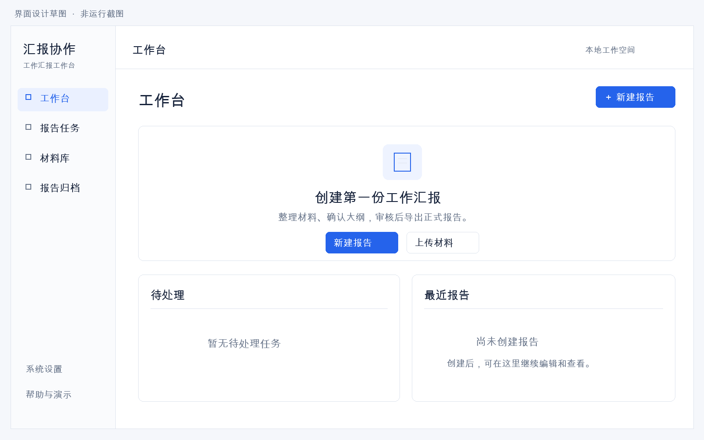
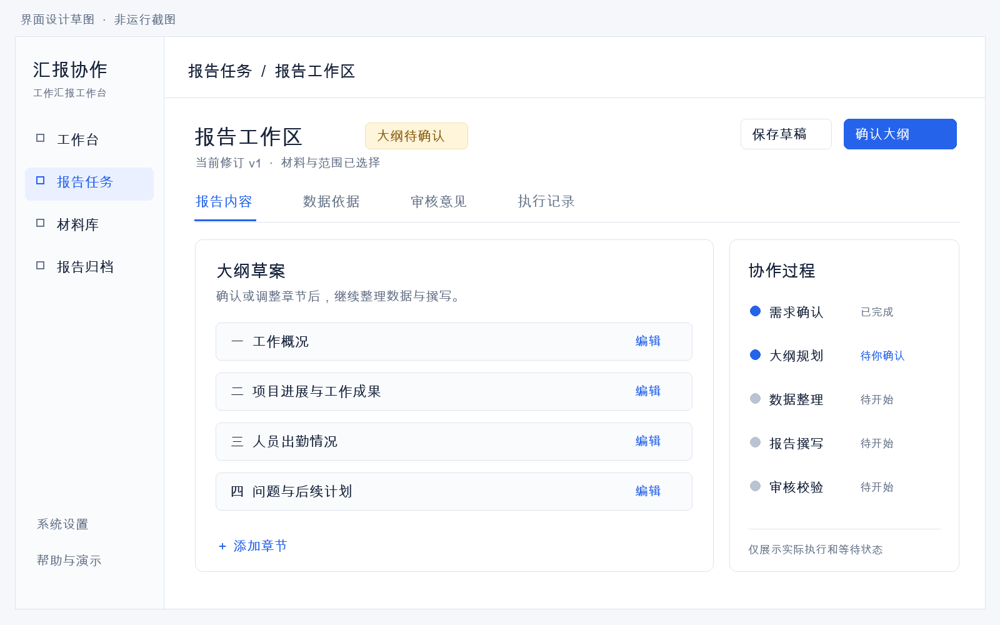

# 完整工作汇报系统开发说明书

第二代系统改版方案 审查稿 R1

2026-10-16功能范围澄清：按用户最新要求，功能及文件格式以[实验指导书功能基线](functional-baseline.md)为准。现有UI、技术框架、工程结构和原版本顺序保留；本稿涉及Word必做、默认人工批准阻断输出等内容由该基线修正。R1 Word文件保留为原审查稿，不覆盖历史内容。

日期：2026年10月15日。当前软件基线：v1.0.0。拟开发目标：v2.0.0。

## 1 审查结论与开发范围

建议重新建设面向日常办公的工作汇报系统。新版采用独立的业务首页、材料库和报告工作区，支持材料准备、需求确认、统计、撰写、审核修改、归档以及多格式导出。旧版保留为历史实验基线，可复用经过验证的数据校验和部分执行逻辑。

用户已确认范围为“完整工作汇报系统：补齐材料管理、考勤与成果统计、审核修改、Word/PDF导出”。本说明书据此定义功能和验收条件，供用户决定是否开发。以下页面图、版本计划、接口和性能指标均为设计目标，尚未实现。

| 决策项 | 推荐方案 |
| --- | --- |
| 产品定位 | 部门工作汇报，从材料到正式报告形成完整操作流程 |
| 界面 | 重建页面结构与交互，替换现有 Streamlit 业务界面 |
| 框架 | 保留 LangGraph 五角色，新增 React 与 FastAPI 应用层 |
| 核心交付 | 材料库、项目/考勤/成果/满意度统计、审核编辑、MD/Word/PDF |
| 使用环境 | 本机单用户，历史持久保存，一次执行一个任务，其余排队 |
| 开发方式 | 六个 alpha 版本加正式版，每版独立 PR、审查、CI、merge、tag |

新系统首页以“新建报告、待处理任务、最近报告”为核心。首次进入显示空状态；不自动填入研发部案例、不生成示例业绩、不展示故障注入和模型技术账本。课程案例仅进入独立演示区，显式加载后才存在。

本轮只交付说明书及设计草图，不启动业务代码开发，不替换旧版页面，不提交或合并实施 PR。用户审查的重点是页面结构、统计口径、完整功能范围及开发顺序。

<!-- pagebreak -->

## 2 旧版问题与需求依据

旧版完成了可运行的五角色实验链路，但它把验证工具、样例数据和业务操作放在同一个页面。技术测试通过并不能证明首页设计合理，也不能代表完整办公产品已经完成。

| 现状 | 对使用者的影响 | 新版处理 |
| --- | --- | --- |
| 首页预填研发季度案例 | 容易把教学场景误认为唯一业务 | 空白新建表单，部门和期间由用户选择 |
| 表单含故障实验及 HTTP 预算 | 创建报告需要理解开发细节 | 实验独立入口，预算放系统设置 |
| 强制三个固定文件名 | 难以整理实际办公材料 | 任意合规文件名，分类与字段映射 |
| 仅四项指标 | 缺少考勤及行政满意度场景 | 增加可选指标组与数据口径 |
| 正文受固定模板严格限制 | 报告阅读效果机械，缺少材料叙述 | 结构化事实加有引用的材料叙述 |
| 一会话一个任务，无历史库 | 刷新、重启和查找旧报告不便 | 任务、材料、修订及产物持久保存 |
| 业务报告仅 Markdown | 不能完成常用 Word/PDF 交付 | 当前批准修订统一导出三种格式 |

仓库已有的实验报告 Word 是课程文档，由独立脚本生成；它不等于系统已经具备业务报告 Word 导出。新版须实现真正的用户导出服务。

### 2.1 需求来源与优先级

教师补充允许任意开源框架，并要求三人一组、提交包含搭建过程和运行截图的实验报告，优先于指导书中 OpenClaw 和五人组队的安排。五个软件 Agent 可以保留，软件角色数与组员人数不必相同。

指导书作为功能参照，重点对齐需求拆解、大纲规划、数据整理、撰写、审核、CSV/TXT/DOCX、本地模拟接口、PDF，以及技术部 Q2、行政部 Q1 两个业务场景。后续开发以本说明书批准范围为基线，不把指导书安装命令直接当成项目实施命令。

本方案不扩展会议纪要、邮件发送、日程、通用聊天、薪资管理或完整企业 OA。部署和课程材料单独提供；用户首页不承担实验报告展示职责。

<!-- pagebreak -->

## 3 开源项目调研与选型

调研于2026年10月15日读取项目官方仓库及文档。以下“参考方式”是本项目的设计判断，不表示这些项目已经集成或在本机验证。

| 官方项目 | 核实的相关能力 | 本项目参考方式 |
| --- | --- | --- |
| DeerFlow | 项目共享文档管理，子 Agent 与工具协作 | 参考材料入口和任务产物组织，保持本项目的汇报主流程 |
| Dify | 工作流、模型管理、日志与观测 | 参考运行详情与设置分区，不构建通用可视化流程编辑器 |
| Open WebUI | 独立内容工作区、Markdown、材料检索与响应式页面 | 参考内容阅读与编辑布局，不照搬聊天产品的首页 |
| LangGraph | 状态图、持久化和人工介入机制 | 继续作为编排基础，为确认大纲和恢复提供检查点 |

来源：[DeerFlow README](https://github.com/bytedance/deer-flow/blob/main/README.md)、[Dify README](https://github.com/langgenius/dify/blob/main/README.md)、[Open WebUI README](https://github.com/open-webui/open-webui/blob/main/README.md)、[LangGraph README](https://github.com/langchain-ai/langgraph/blob/main/README.md)。

### 3.1 推荐技术组合

前端采用 React、TypeScript、Vite 和 Tailwind CSS，按需使用 shadcn/ui 的基础控件；后端采用 FastAPI、Pydantic 和现有 httpx 适配能力。LangGraph 执行五角色流程，SQLite 保存业务记录与检查点，本地目录保存不可变材料和报告文件。依赖具体版本在批准开发后的首个 PR 验证并锁定。

选择这套组合是为了支持材料表格、字段映射、报告编辑和审核工作区，解决旧界面的交互限制。初版使用模块化单体，一个后台顺序执行器；不引入微服务、Redis、Celery、向量库、在线协同或插件市场。进度先用两秒轮询，只有实际需要时再升级事件推送。

直接部署完整 Dify 或 DeerFlow 是可选路线，但会引入本项目用不到的平台功能，并需要适配自己的材料、统计和报告版本规则。推荐自建业务界面并复用已有 LangGraph 能力。

Dify 仓库说明其许可证含附加条件；Open WebUI 也说明其当前代码包含品牌保留等要求。方案只参考公开交互思路，不复制标识和页面代码。若开发时复用代码，应按所选文件实际许可证保留声明。LangGraph 官方仓库列示 MIT 许可证。[Dify 许可证说明](https://github.com/langgenius/dify#license)、[Open WebUI 许可证说明](https://github.com/open-webui/open-webui#license)、[LangGraph](https://github.com/langchain-ai/langgraph)。

<!-- pagebreak -->

## 4 页面结构与视觉规范

产品暂名“汇报协作工作台”。所有日常功能围绕报告和材料展开，左侧固定导航，顶部提供当前页面名称、搜索或主操作；页面内部避免把全部配置堆成长表单。

| 页面 | 主要内容 | 主操作 |
| --- | --- | --- |
| 工作台 | 待补充、待确认、最近报告和空状态 | 新建报告 |
| 报告任务 | 按状态筛选、搜索、任务列表 | 打开报告工作区 |
| 材料库 | 材料分类、预览、校验、版本与关联 | 上传并检查材料 |
| 报告工作区 | 正文、大纲、数据依据、审核意见、执行记录 | 确认大纲或提交审核 |
| 报告归档 | 已批准报告、修订、导出记录 | 查看或下载已批准版本 |
| 系统设置 | 模型连接、统计政策、模板、存储和备份 | 保存设置 |
| 帮助与演示 | 使用说明；显式加载的隔离案例 | 打开独立演示工作区 |

### 4.1 设计标准

采用浅灰页面底色、白色内容区、深色正文和单一蓝色主操作，状态配合文字和图标，不只依赖颜色。桌面侧栏宽约224px，正文14–16px，使用8px间距体系；长文阅读区控制行宽，表格支持横向滚动。大屏可并列显示文档与意见，窄屏改为切换面板，主操作始终可达。

正式界面只显示用户能据此行动的信息。首页不出现固定业务案例、故障开关、原始 JSON、HTTP 次数和节点调试输出。高级运行详情可以查看实际模型用量，默认收起；缺少 usage 时显示“未知”。

所有页面设计加载、空数据、局部失败和权限范围内不可用状态。按钮具有焦点样式，表单有标签与错误位置；键盘可完成新建、材料选择和审核。目标在1440px、1280px及390px宽度检查，不承诺手机上具备桌面同等编辑效率。

以下两页为静态设计草图，表达布局和交互阶段，不是已开发页面或运行截图。实际 UI 在首个版本先做可交互预览，经用户审查后固定方向。

<!-- pagebreak -->

## 5 首页设计

首页首次打开的空状态。页面没有部门案例或虚构业绩；“新建报告”和“上传材料”是主要入口。

### 5.1 首页行为

有真实数据后，待处理区显示需要补充材料、确认大纲或处理审核意见的任务。最近报告只列本机数据库中的记录，标题、状态和时间均来自实际任务。空数据库不使用演示记录填充列表。

点击“新建报告”进入独立步骤页：填写主题与范围、选择材料、确认内容要求。用户可以保存草稿；缺关键材料时清晰提示缺什么、如何补充。模型连接未配置时，设置入口提示一次，报告不会静默切换为模拟模式。

演示数据通过“帮助与演示”显式加载到独立空间，并全程标明“演示”。演示材料、任务和产物不会混入正常首页及归档。故障注入只在开发测试入口和自动化中启用。

<!-- pagebreak -->

## 6 报告工作区设计

图示为“大纲待确认”的交互状态。名称和内容用于展示控件位置，不是本项目实际生成的报告。

| 区域 | 展示与操作规则 |
| --- | --- |
| 顶部 | 标题、当前修订、业务状态；按阶段显示主按钮 |
| 正文与大纲 | 初期确认章节，生成后预览/编辑；不直接编辑权威统计值 |
| 数据依据 | 指标、公式、范围、材料版本和行/段落定位 |
| 审核意见 | 严重程度、位置、原因；点击定位到相关章节 |
| 执行记录 | 五角色实际开始/结束/失败事件，显示已完成步骤数 |
| 右侧协作区 | 当前步骤、下一步需要用户做什么、可取消状态 |

生成结束后主操作变为“提交审核”或“确认归档”。只有当前修订经程序复核、模型审核和用户确认，才显示正式导出。草稿预览始终明确标注，避免把“任务执行结束”误解为“报告已批准”。

页面保留用户当前阅读位置和编辑草稿，切换数据依据或审核意见不会重新运行模型。状态更新只读取已有任务，不自动重提需求。

<!-- pagebreak -->

## 7 完整用户流程与智能体职责

1. 用户在材料库上传文件，查看分类、字段映射和校验结果，确认后入库。
2. 新建报告，填写部门、期间、主题、章节、重点和输出格式，选择已确认材料。
3. 系统预检材料与配置；Manager 解析需求，缺必要信息时提出具体补充项。
4. Planner 生成大纲。用户可增删或调整章节，确认后保存不可变的大纲修订。
5. Data 实际调用受限统计和材料工具，产出带来源的指标与证据；缺数据则暂停补充。
6. Writer 依据大纲、冻结事实和可引用的材料生成草稿，不自行补造业绩。
7. Checker 执行程序核验与模型审核，输出可定位意见；可修正问题进入有限返工。
8. 用户查看草稿、依据和修改差异，手动修改或给出修改要求，再提交审核。
9. 当前修订审核通过后，用户确认归档；系统生成绑定该修订的正式产物。
10. 用户下载 Markdown、Word、PDF；后续修改建立新修订，保留上一正式版本。

| Agent | 输入与职责 | 可检验输出 |
| --- | --- | --- |
| Manager | 用户需求、可用材料索引；明确范围与缺项 | 结构化需求、子任务、补充问题 |
| Planner | 已确认需求和指标类别；规划章节 | 可编辑大纲与章节证据需求 |
| Data | 已授权材料版本、部门和期间；调用工具 | 指标、口径、来源定位和材料缺口 |
| Writer | 确认大纲、事实集合与证据片段；生成叙述 | 结构化章节、引用与草稿 |
| Checker | 当前草稿、权威事实、大纲和来源 | 定位意见、严重程度及修改要求 |

五角色之间传递结构化状态及实际前序结果。用户确认大纲和最终稿属于业务流程；测试报告、课程截图和开发日志不插入生成的部门工作汇报。

<!-- pagebreak -->

## 8 材料管理与数据接入

材料库支持中文文件名和多份材料，不再强制文件名为 projects.csv 等。上传后由用户选择类型；系统提供字段匹配建议及预览，确认后生成材料版本。模板下载用于帮助整理输入，不预装业务数据。

| 类型 | 首版支持内容 | 来源定位与约束 |
| --- | --- | --- |
| CSV | 项目、快照、考勤、成果、满意度明细 | 原始物理行、字段名；确认日期/单位/字段映射 |
| TXT | 说明、问题、工作记录 | 段落或行区间；需确认部门和有效期间 |
| DOCX | 正文段落和普通表格 | 段落序号、表格/行/单元格；不承诺稳定页码 |
| 本地模拟接口 | 内置只读业务数据提供器 | 接口版本、响应快照和哈希；与文件同样校验 |

首版不支持旧版 .doc、宏、OCR、扫描 PDF、复杂文本框和任意外部 URL。DOCX 中的普通业务表格经映射确认后可以转为结构化记录；模型从段落抽取的数字先进入待确认区，不能直接成为权威指标。

导入规则建议每文件不超过10MiB、CSV不超过20,000行、DOCX解压后不超过50MiB；这是待实施验证的上限，超限给出拆分指引。检查真实格式、编码、压缩包条目、日期、重复 ID 和非法数值，上传路径由服务端生成。

### 8.1 材料版本与范围

每个材料记录 material_id、版本、显示名称、类型、哈希、上传时间、部门、期间和校验状态。文件原件不可原地修改，替换或修正生成新版本。任务绑定所选版本，后续材料变更不改变历史报告。

同字节、同分类、同映射配置的重复导入返回已有版本；冲突记录不能悄悄覆盖。批次先校验再整批确认，避免部分写入。删除被报告引用的材料先归档隐藏，保留引用可读。

部门与日期不明确的文字材料显示“范围未确认”。如果用户要求按季度归因，必须先确认其适用范围；未确认材料不能作为该季度发生事项的依据。

<!-- pagebreak -->

## 9 统计数据与业务口径

所有数值由确定性工具计算，模型负责理解需求和组织文字。新增指标必须先定义输入、公式、范围、单位和缺失规则。指标详情可打开来源；“未提供、未定义、0”分别表示不同结果。

| 数据组 | 最小业务字段 | 统计规则 |
| --- | --- | --- |
| 项目主表与快照 | 项目ID、归属部门、生效日期；快照日期、状态、进度、实际完成日期 | 期末项目按结束日前有效项目和最新快照；本期完成另按完成日期计算 |
| 考勤计划与记录 | 人员名册、工作日历、计划/实际出勤工时、部门、请假/缺勤/迟到 | 出勤率为计入出勤工时合计÷计划工时合计；按固定政策处理请假 |
| 成果明细 | 成果ID、部门、发生日期、类别、名称、关联项目 | 按成果ID去重，按期间/类别统计，重复导入不增加成果数 |
| 满意度记录 | 反馈ID、服务部门、日期、评分、量表上下限、有效标记 | 同量表有效记录计算均值，并显示有效样本数 |

### 9.1 项目与期间

业务期间采用开始日包含、结束日排除。界面可让用户选择季度或起止日期，再明确显示转换后的范围。期末项目总数需要项目主表及历史快照：如果现有材料只能支持“区间内有记录的项目数”，必须使用该名称，不得展示成期末存量。

项目完成状态比例与本期交付数分开，材料缺快照时标记缺失。不能直接把旧样例中的“3项、2项、2/3”当作新规则答案；新的标准答案由独立手算确定。

### 9.2 考勤与满意度

初版固定以工时为考勤单位，请假不从计划工时分母扣减，单独列示。每个人每天计入出勤工时取实际工时与计划工时较小值，超计划部分单列待核对，不自动认定加班。未来如需扣减请假，应新增命名政策与口径版本。

人员名册和工作日历确定应有记录范围。缺计划或缺实际记录时，整体出勤率为未定义，另示完整记录人日数÷应有记录人日数的覆盖率；不能仅累加已知记录就算完整率。全部齐备且分母大于0才计算出勤率，零分母为未定义。

满意度默认显示同量表有效评分均值及量表，例如4.2/5，另列样本数；不同量表分组显示，不直接混算或换成百分比。数据缺失时提示补充调查记录。没有来源就不生成“满意度提高”等结论。

<!-- pagebreak -->

## 10 撰写质量与审核修改

新版报告由摘要、工作进展、成果、考勤、问题、后续计划等可配置章节组成，用户可删去无关指标组。允许调整重点和语气，但数据缺失的章节必须说明缺项或由用户确认移除，不能通过润色补全事实。

Writer 输出按段落组织，每个事实句绑定 fact_id 或材料引用，建议与已发生事实分开。数值表格和核心数值句由程序依据事实对象渲染；材料叙述引用已确认片段。模型不能通过改写 Data 结果来使草稿通过审核。

改善旧版固定事实行的阅读体验，需要调整 Writer/Checker 契约和渲染器，不是简单去掉校验。程序校验数值、单位、范围、来源、必需章节和版本；模型检查逻辑、措辞及无依据推断。自然语言语义仍需人工复核，系统不宣称所有文字都能自动证明真实。

### 10.1 编辑与重新审核

用户在章节编辑器内修改文字或提出重写要求，保存为新修订。核心统计值是只读引用；需要更正数字时返回材料或口径页修正并重新统计。核心数值通过fact_id插入只读事实块。正文新增带数字内容必须关联事实引用，或标为建议/待核对；未确认的数值项阻断归档。程序保证结构化数值、单位和来源一致，任意自由文字中的事实与因果仍由模型和人工复核，不承诺自动识别全部错误。

审核意见包含章节、段落/事实位置、问题代码、说明和严重程度；点击意见可定位，用户可标记已处理或提交说明。程序阻断错误不能通过“忽略”直接批准；非阻断建议可以记录人工取舍。

每个已批准版本不可原地覆盖。正文、材料、范围或大纲发生变化后，建立新修订并使对应下游审核失效；旧正式版仍可查看，界面明确哪个是当前草稿、哪个是最近已批准版本。

### 10.2 自动返工与人工确认

自动返工默认最多两轮，保留前稿、反馈和差异。超过上限停为“需要人工修改”，保留草稿和已消耗预算。用户继续修改是新操作，界面提示是否需要模型请求，剩余预算不被重置。

模型审核通过后仍需用户确认归档。导出只接受当前已批准快照；有阻断问题、待审核修改或产物失败时，不显示“全部完成”。

<!-- pagebreak -->

## 11 Word 与 PDF 交付

三种格式来自同一个不可变 ReportSnapshot，包含报告ID、修订、需求/材料/口径版本和内容哈希。正式业务报告只包含部门汇报内容；模型预算、角色日志、课程实验说明与 JSON 证据另行保存。

| 格式 | 交付目标 | 必须验证 |
| --- | --- | --- |
| Markdown | 标题、段落、表格和引用附件 | UTF-8内容可读，修订与正文一致 |
| Word | 可编辑封面字段、标题样式、页码、表格和来源附录 | 中文正常，长表跨页重复表头，不截字，不出现未解析字段 |
| PDF | 与本次 Word 对应的固定版式文档 | 页序/表格/数值一致，字体正常，文件可打开 |

建议使用 python-docx 生成 Word，再由独立安装的 LibreOffice headless 转换为 PDF。发布环境须检查转换器与中文字体；不能依赖开发助手私有运行时。转换在受控临时目录执行，设置超时和输出校验。

默认模板采用正式部门工作汇报版式，支持用户修改标题、部门、期间、落款和是否显示来源附录。初版提供一套稳定模板，暂不做拖拽模板设计器或任意 Word 模板兼容。

### 11.1 导出状态与失效规则

Word和PDF分别保存生成状态、文件哈希和错误信息。PDF转换失败时，已生成Word可下载，PDF显示失败和重试入口；报告可保持已批准，但该次交付不能显示“三种格式全部成功”。仅重试导出不重新调用模型。

新修订不复用旧修订文件。下载时校验产物所属快照；导出期间的正文修改不会混入正在生成的文件。前端预览是内容预览，分页以实际Word/PDF为准。

### 11.2 版式验收材料

至少覆盖中文长标题、十页以上报告、多页长表、空数据章节、长材料名称和来源附录。逐页检查中文、行高、页码、分页和表头，再核对三格式指标与引用同源。不能仅凭生成函数返回成功就判定文档可交付。

<!-- pagebreak -->

## 12 系统架构与接口

建议部署结构为：React页面 → 同源FastAPI接口 → 业务服务与LangGraph执行器 → SQLite及受控本地文件。一次运行绑定材料快照、口径和模型配置版本；LangGraph检查点负责图状态，业务表负责任务索引、修订、意见和产物。

生产式本地启动由后端提供前端构建结果和/api/v1；开发时使用Vite代理。两秒轮询读取任务状态和增量事件，先满足可靠查看；不同时实现轮询、WebSocket和SSE三套机制。

| 主要记录 | 保存内容 |
| --- | --- |
| MaterialVersion | 文件原件、字段映射、分类、范围、来源哈希及确认状态 |
| Report与Revision | 需求、确认大纲、事实、正文、父修订及审核状态 |
| Run与Event | 阶段、事件序号、预算账本、错误位置、节点检查点关联 |
| Review与Decision | 对应修订、问题位置、审核结果、用户确认及操作时间 |
| Artifact | 格式、快照哈希、生成状态、文件位置及文件哈希 |

### 12.1 最小接口草案

| 接口 | 作用 |
| --- | --- |
| POST /api/v1/materials/import | 上传、分类与解析预检，返回导入草稿 |
| POST /api/v1/imports/{id}/confirm | 确认字段映射并原子保存材料版本 |
| POST /api/v1/reports | 保存报告需求草稿 |
| POST /api/v1/reports/{id}/runs | 以材料快照和幂等键创建一次运行 |
| GET /api/v1/runs/{id} | 查看状态；事件通过after_seq读取增量 |
| POST /api/v1/runs/{id}/decisions | 确认大纲或补充输入，携带expected_version |
| PATCH /api/v1/reports/{id}/draft | 保存新修订，拒绝覆盖过期版本 |
| POST /api/v1/revisions/{id}/review | 发起当前版本审核；approve另记录人工确认 |
| POST /api/v1/revisions/{id}/exports | 对已批准快照生成所选格式 |

列表、材料预览、取消、下载和备份接口在对应阶段补齐；OpenAPI定义为前后端共同契约。接口不接受客户端任意服务器路径，不返回密钥、绝对私有路径或供应商原始异常文本。

<!-- pagebreak -->

## 13 运行可靠性与成本

任务执行状态与报告审核状态分开。运行状态覆盖排队、执行、等待人工确认、取消中、已取消、已中断、失败和结束；报告状态覆盖草稿、待审核、需修改和已批准。阶段字段描述当前角色，避免堆积大量互相矛盾的顶层状态。

### 13.1 防重和中断

创建运行携带Idempotency-Key：同键同请求返回原运行，同键不同请求返回409。编辑和确认携带expected_version，旧页面写入返回409并提示刷新。数据库约束负责跨标签防重，页面禁用按钮只是辅助。

节点边界写入完整检查点后才可以恢复。服务重启保留历史任务和材料，将执行中任务标为“已中断”，提示从安全边界继续。等待大纲确认的任务可恢复显示；恢复必须沿用原材料、版本及预算。

如果模型已经响应而本地尚未持久化，无法保证不重复请求和计费。将该次尝试标为“结果未知”，说明再次请求的影响，由用户显式重试，不宣传严格恰好一次。取消立即阻止后续节点；已经发出的请求可能仍产生费用，不能承诺撤销供应商计费。

SQLite使用短事务及写入等待；模型请求、文件解析、PDF转换期间不持有写事务。首版单执行器、一次一个任务，不做多节点高可用。

### 13.2 模型与材料保护

真实业务使用用户配置的模型，未配置明确引导设置，不静默使用mock。演示和自动化均可离线；开发阶段默认不新增付费调用。必要的真实验收按单独运行预算执行，复用已保存结果，刷新、查看与下载均不调用模型。

每次物理HTTP尝试前持久预留请求和输出预算，重试也计入；恢复不清零。实际输入/输出usage与预留上限分别显示，缺值为未知。用量明细进入任务运行详情，首页不强迫用户理解token参数。

密钥只由本地配置管理，不进入前端状态、Git、导出和日志。材料预览按文本安全渲染，限制HTML、压缩包及路径；工具只读取本次授权材料，不开放任意文件或网络工具。初版仅监听回环地址，局域网与公网、多用户权限另立范围。

<!-- pagebreak -->

## 14 分版本开发计划

以下为拟定里程碑，未代表已实现。先审查本说明书；批准后从alpha.1开始，每个阶段都有独立可运行成果和退出条件。以验收门槛推动版本，不用已通过测试的数量代替产品完成度。

| 版本 | 具体开发内容 | 进入下一版的条件 |
| --- | --- | --- |
| v2.0-alpha.1 | 设计规范、导航、首页、新建草稿；React/FastAPI/SQLite最小真实链路 | 空数据库首页无案例；草稿保存后刷新能读取；建立正常/演示空间隔离；用户认可主要界面 |
| v2.0-alpha.2 | 材料库，CSV/TXT/DOCX预览、映射、校验、版本、模拟接口 | 中文文件可导入；错误定位准确；重复不多计；模拟接口限演示空间 |
| v2.0-alpha.3 | 项目、考勤、成果、满意度工具与来源详情 | 独立手算匹配；缺失/零分母/冲突/跨部门及日期边界通过 |
| v2.0-alpha.4 | 五角色重编排、大纲确认、检查点、队列、防重、取消与预算 | 完整材料可生成草稿；刷新不重发；中断状态与恢复边界可验证 |
| v2.0-alpha.5 | 正文编辑、意见定位、修订差异、重审、归档、三格式导出 | 修改使旧审核失效；正式产物对应当前批准快照；中文长表检查通过 |
| v2.0-alpha.6 | 演示隔离、错误流程、响应式、安装、备份恢复、端到端检查 | 两业务场景和30分钟稳定性检查通过；新克隆可启动并还原历史 |
| v2.0.0 | 修复验收问题、更新课程报告和截图、正式发布 | 用户验收及一次受限预算live链路通过；CI/审查后合并并核对tag |

### 14.1 协作和交付方式

A负责后端、编排与数据契约；B负责前端页面和交互；C负责独立测试、导出版式和验收文档；主协调者维护接口、集成、版本和发布。AI角色辅助开发，Git仍如实记录实际开发者，不伪造三名人类组员。

每版先写任务清单与接口，再按文件范围分派实现，交叉审查后集成。PR必须写明用户可见变化、实际验证、未完成项和风险；CI通过后merge并打对应tag。alpha版本清楚标记阶段能力，不提前称为成熟交付版。

本说明书阶段不承诺固定天数。alpha.1完成后根据实际界面返修和依赖验证估算后续工期；alpha.4持久恢复、alpha.5文档导出是主要工作量，不能将整项改版描述为单次换肤。

<!-- pagebreak -->

## 15 最终验收与课程文档

| 编号 | 必须展示的验收行为 |
| --- | --- |
| U01 | 首次首页无预置案例、实验开关、原始JSON或虚构统计；键盘可完成新建 |
| M01 | CSV/TXT/DOCX中文文件名导入、预览、映射、确认、替换和来源定位有效 |
| D01 | 独立手算覆盖项目/考勤/成果/满意度，缺失、0和未定义正确区分 |
| A01 | 五角色消费真实前序输出；确认大纲实际暂停/继续，不是计时动画 |
| R01 | 修改正文/材料后旧审核失效；阻断问题不能忽略批准；历史正式版可回看 |
| E01 | 三格式绑定同修订；实际文件可打开，中文、长表、页码正确；PDF失败单独显示 |
| T01 | 刷新不重提，跨标签防重，取消、中断恢复和预算耗尽均保留可解释状态 |
| B01 | 技术部Q2：项目、考勤、成果齐备，完成材料到正式报告的全流程 |
| B02 | 行政部Q1：满意度有真实输入依据；移除材料后正确要求补充 |
| S01 | 连续30分钟执行/查看多个任务，记录错误、内存及恢复，留存原始结果 |
| P01 | 新克隆锁定安装、启动、备份还原通过；演示数据与正常材料隔离 |

上述是计划验收项目，不是当前结果。正式版至少在明确请求与token上限后，用已确认材料完成一次真实模型全链路，覆盖新契约、大纲暂停/继续、审核和导出；其余回归默认离线。本轮说明书阶段不调用模型。若真实链路未验收，须标记真实集成未验证，不能宣称完整真实交付。错误注入不冒充模型自然错误；报告内截图必须来自最终对应版本的实际运行。

### 15.1 实验报告如何更新

新版课程报告记录环境、安装启动、五角色接口、完整时序、数据口径、两业务场景、审核修订、实际Word/PDF、问题解决及架构取舍。架构分析延续不少于2000字要求，补充新界面与后端、持久任务和人工节点。

课程案例保留在报告与独立演示材料中，不进入正常首页默认状态。截图注明版本、模式、输入来源和实际结果；新系统未验收前不替换旧证据。视频、答辩PPT和个人总结列为课程提交附件，是否需要补做按老师最终安排，不作为业务页面功能。

三人组队的人数要求仍按教师安排处理。AI开发协作可以记录，但不能替代真实组员身份或宣称教师已认可。

<!-- pagebreak -->

## 16 用户审查记录与实施门槛

你已经确认完整工作汇报的功能范围。建议重点审查下面四项；可以直接写“通过”“修改”或“暂缓”，并说明希望调整的位置。

| 审查项 | 推荐决定 | 用户意见 |
| --- | --- | --- |
| 产品页面 | 接受首页、材料库、任务工作区、归档和设置结构 | __________________ |
| 技术路线 | React与FastAPI重建应用，保留可验证的LangGraph能力 | __________________ |
| 统计口径 | 期末项目/本期完成分开；考勤工时；满意度同量表均值 | __________________ |
| 开发批次 | 从alpha.1界面和草稿真链路开始，再按六阶段推进 | __________________ |

批准开发后，第一版先提供真实可交互的首页、报告任务和草稿保存，供你实际操作审查。页面方向通过后再扩展材料和编排功能，减少后期反复推倒界面。

本说明书不改变v1.0.0历史结论，也不把新需求写成旧版已经完成。拟开发系统、设计图和拟验收行为均应在实际完成后更新为真实记录。

### 16.1 核对依据

本地依据：用户提供的实验指导书第2.3、5.4、5.5节，教师补充，用户本轮功能选择，以及README、src/office_agents/web_ui.py、agent_schemas.py、workflow.py、web_runtime.py、agents/writer.py和v1.0验收记录。两个AI角色为本说明书提供只读需求及架构审查，未执行新系统开发。

开源参考范围仅为官方仓库和文档阅读，没有安装或运行这些参考产品。项目能力、许可证与文档会变化；实施时应锁定实际选用版本。

- [DeerFlow项目与文档管理](https://github.com/bytedance/deer-flow/blob/main/README.md#projects)：参考材料与任务组织。
- [Dify官方仓库](https://github.com/langgenius/dify)：参考工作流运行和设置分区。
- [Open WebUI官方仓库](https://github.com/open-webui/open-webui)：参考内容工作区和响应式布局。
- [LangGraph持久化](https://docs.langchain.com/oss/python/langgraph/persistence)：检查点能力依据。
- [LangGraph人工介入](https://docs.langchain.com/oss/python/langgraph/interrupts)：大纲确认与继续的机制依据；恢复和副作用仍须实现并验证。

作者：项目开发协作助手。审查人：项目所有者。文档状态：待审查，未批准实施。
