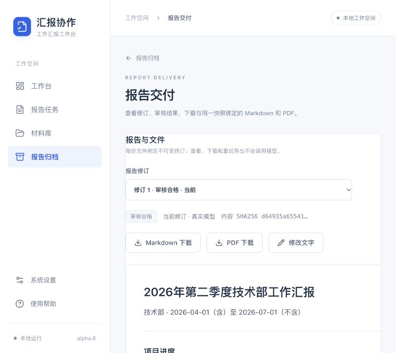
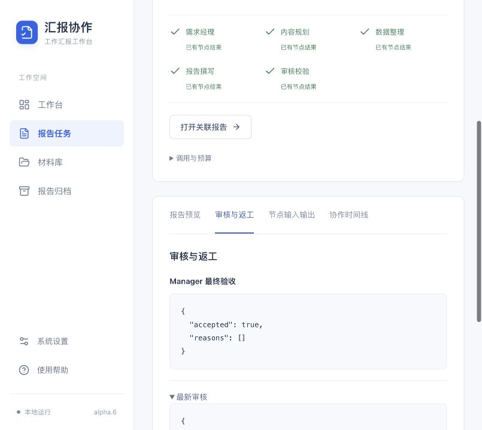
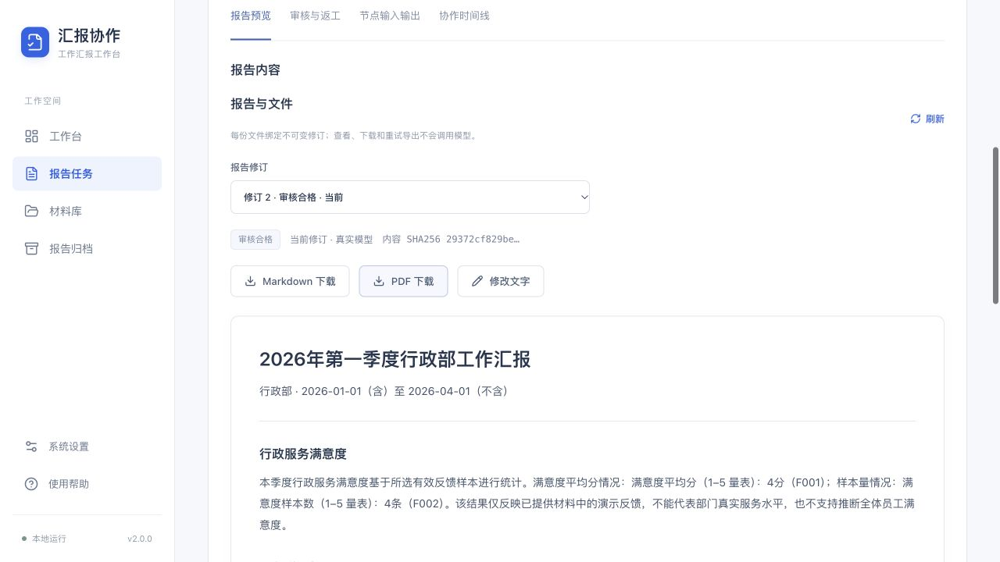
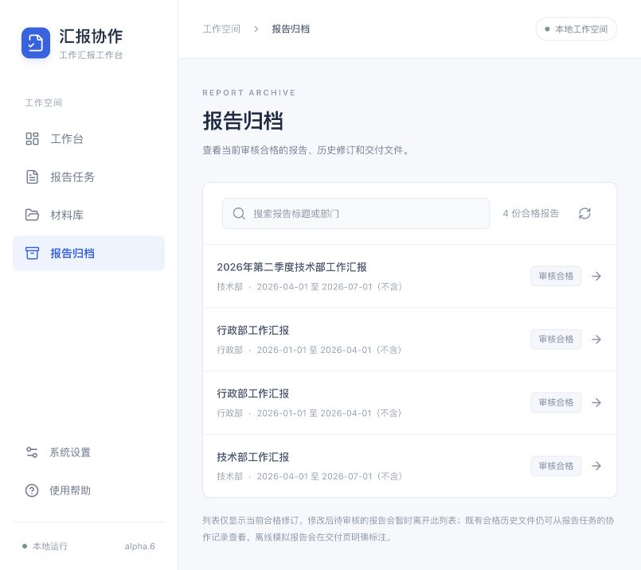

# 基于LangGraph的多AI Agent智能办公协作系统实验报告

课程：软件体系结构（研究生）

项目：multi-agent-office-lab

报告版本：v2.0.0

姓名：________________  学号：________________  班级：________________

指导教师：________________  实验日期：2026年10月17日

代码仓库：https://github.com/Thedaiyyds/multi-agent-office-lab

代码验收基线：v2.0-alpha.6，合并提交d60273b08609c6e6a4965cb3035fe3f4604df91a。

## 一、实验目标与要求依据

本实验实现一个面向“部门工作汇报”的多智能体办公系统。用户在正常网页中选择普通材料，或明确授权固定本地数据接口，输入部门、年份期间与重点，系统自动完成需求拆解、内容规划、数据整理、报告撰写、审核修正和最终验收，输出规范Markdown与PDF。实验关注职责划分、通信契约、任务调度、数据正确性、异常处理和可复现交付。

教师补充允许选择任意开源框架，不强制OpenClaw。因此采用LangGraph保留五个业务Agent角色，结合React、FastAPI和SQLite构建本机系统。指导书规定的TXT、CSV、DOCX作为输入材料格式；Markdown、PDF作为业务报告输出格式。课程实验报告的Word文件属于提交材料，与系统生成的业务报告是两类文档。

教师要求三人一组。本项目实际人类开发者为一人，使用多个AI开发角色辅助设计、实现、测试和交叉审查。五个业务Agent与AI开发角色不是人类组员；报告和Git如实记录单人开发与AI辅助，不以虚构姓名、作者或提交制造三名人类参与的印象。

| 指导书功能 | 实际实现与验证 |
| --- | --- |
| 接收与拆解需求 | 网页保留自然语言原文，Manager生成结构化需求和任务；缺项明确提问 |
| 内容规划 | Planner接收Manager实际结果，确定章节、要点和数据类别 |
| 数据整理 | Data按Planner要求读取已授权材料或固定本地接口，计算四类指标与来源 |
| 报告撰写 | Writer消费大纲、事实、文字片段，形成叙述、建议和规范Markdown |
| 审核校验 | Checker程序检查与模型审核结合，反馈Writer有界修正，末尾Manager验收 |
| 多Agent协作 | LangGraph节点及条件边，真实输入输出、事件、状态和用量持久保存 |
| 规范文档输出 | 审核合格快照自动生成同源.md/.pdf，编辑后重审，历史文件可追溯 |
| 安装、运行与分析 | 无密钥源码副本复现、两场景真实模型运行、异常测试与实际截图 |

实施以课程指导书2.3、5.2.3、5.3.3、5.4.3节、教师补充及项目实施说明书R2为依据。默认自动流程不要求用户逐步人工批准大纲或手动转交Agent；人工修改与复审作为辅助能力。

## 二、方案设计与五角色协作

### 2.1 总体架构

系统采用本机模块化单体：React/Vite界面通过同源`/api/v1`调用FastAPI，SQLite保存业务记录，受控本地目录保存材料原件与报告文件，单后台队列驱动LangGraph。角色通过结构化状态传递结果，不需要五台服务器，也不将多智能体等同于分布式部署。

模型承担语言理解、规划、受约束撰写和语义审核；准确数值、来源筛选及可形式化规则由确定性程序负责。五个角色可以共用同一兼容模型服务，职责、输入和输出契约各自独立。页面读取实际执行事件与持久状态，不用计时动画替代真实执行。

| 组件 | 职责 | 源码位置 |
| --- | --- | --- |
| React工作台 | 材料、任务、运行过程、修订与下载 | frontend/src/ |
| FastAPI入口 | 本机请求、工作区、版本及路由约束 | workbench/api.py |
| 材料服务 | 三格式解析、预览映射、校验、冻结版本 | workbench/materials.py |
| 统计服务 | 项目、考勤、成果、满意度及来源 | workbench/statistics.py |
| 执行服务 | LangGraph、模型、队列、事件、预算与取消 | workbench/execution.py |
| 交付服务 | 不可变修订、重新审核、文件门禁和恢复 | workbench/delivery.py |
| PDF渲染 | 从冻结Markdown生成嵌字中文PDF | workbench/pdf_export.py |

表内后端文件均位于src/office_agents/下。Pydantic契约拒绝多余字段和不合法结构，JSON解析及业务规则继续检查模型结果；“返回了JSON”不等于“业务正确”。

### 2.2 角色与传递路径

主流程为：用户需求及授权材料 → Manager → Planner → Data → Writer → Checker → Manager最终验收 → 冻结报告修订 → Markdown/PDF。

| 角色 | 实际输入 | 输出与作用 |
| --- | --- | --- |
| Manager起始 | 原始需求、已保存范围、材料索引、原文期间提示 | 主题、部门、期间、重点、章节及任务拆解；缺信息时提问 |
| Planner | Manager实际结果、可用数据类别 | 章节大纲、每章目的和数据需求，直接驱动Data |
| Data | 需求范围、Planner类别、已选版本与接口授权 | 权威指标、限制、冻结来源、可引用文字片段 |
| Writer | 大纲、事实、片段和上一轮审核 | 叙述与建议，程序按授权引用渲染数值和Markdown |
| Checker | 实际叙述、大纲、事实、来源及程序问题 | 程序核验、模型审核、问题位置和修正意见 |
| Manager最终 | 正文、统计、限制、Checker结论及完整稿哈希 | 接受或拒绝本次结果；接受后才形成合格交付 |

末尾回到Manager仍是五种角色。Checker未通过且预算允许时回到Writer，Writer接收上一稿及精确问题片段再修改；最多两次返工。缺信息/材料为needs_input，超限不通过为review_failed，模型、数据、预算等异常为failed，不生成假合格报告。


图1 正常工作台入口。用户按普通业务操作提交，案例不占据首页，也无需切换独立演示产品。

### 2.3 数据与统计口径

报告期间统一为[start_date,end_date)，开始日包含、结束日排除。2026年第二季度对应2026-04-01至2026-07-01。Manager的部门与期间须有原文依据；保存过的需求范围和章节不得被模型擅改。季度提示由程序解析并提供给Manager复制，仍重新核验其业务输出。

材料确认后冻结原始字节、字段映射、分类、部门/期间、版本及SHA256。最多20条预览不影响全量统计。同业务键完全相同的记录合并来源，不重复计数；不同值冲突阻断统计，不用上传顺序决定真值。同名同分类多个历史版本要求选择一个。TXT/DOCX文字中的数字不直接变成权威统计。

| 数据类别 | 计算规则 | 必须保留的限制 |
| --- | --- | --- |
| 项目 | 取结束日前最新有效快照，按项目ID识别数量、完成状态和比例 | 只反映所选材料可识别项目；本期完成另依据实际完成日期 |
| 考勤 | person_id+date唯一；计入工时=min(实际,计划)，超计划另列核对 | 缺值不当0；无完整声明清单时只有样本比率，没有季度整体率 |
| 成果 | 成果ID去重，按部门、日期和类别汇总 | 完全重复合并，冲突阻断 |
| 满意度 | 排除明确无效项，按相同上下限量表计算均值与样本数 | 不跨量表混算，不编造满意百分比或往期提升 |

考勤请假不从计划分母扣除。用户提供唯一人员名单与排班日期时，人员×日期构成声明应有人日；记录完整且计划工时大于0后才可计算该声明范围出勤率。没有清单时显示样本人日与工时，整体率和覆盖率未定义，不推断未声明季度排班。

### 2.4 审核、修订与同源交付

Writer使用`[[fact:F001]]`和`[[note:N001]]`引用授权事实/片段，由程序渲染数值、统计口径表和来源。程序拒绝未授权裸数字、非法引用、章节缺失、HTML及外部链接结构；建议单列为尚未发生。Checker模型认可不能覆盖程序问题，业务语义仍需结合来源判断。

审核合格快照绑定需求、大纲、事实、来源、正文和内容哈希，并保存同一哈希的Checker与Manager回执。Markdown直接保存快照正文；PDF解析同一冻结Markdown，不另调模型重写。PDF嵌入仓库附带的LXGW WenKai v1.522 OFL字体子集，采用A4、跨页表头和页眉页脚，无需Word或系统中文字体。

编辑只接叙述与建议，保存产生新修订，旧审核不能直接复用；新稿必须经过Checker→Manager。旧合格版可作为历史下载，明确非当前。需求版本改变后报告状态回draft，旧文件不能冒充新范围。每次下载校验快照、验收凭据和文件SHA；损坏可离线重导出，不重复模型调用。

## 三、环境搭建与运行过程

开发环境为macOS Apple Silicon。实际核对的工具为Python3.12.15、uv0.12.23、Node24.15.0和npm11.12.1；项目统一以Python3.12复现，依赖以uv.lock和frontend/package-lock.json为准。CI使用Ubuntu及Node22。后台锁采用Unix fcntl、启动脚本采用Bash，现按macOS/Linux运行；Windows使用WSL2，未声明原生Windows已验证。

首次下载源码、Python和依赖需要网络。正常安装启动命令为：

```bash
git clone https://github.com/Thedaiyyds/multi-agent-office-lab.git
cd multi-agent-office-lab
bash scripts/start_workbench.sh
```

脚本依次安装锁定Python依赖、运行npm ci、构建前端、启动office-workbench。浏览器打开http://127.0.0.1:8520，保持终端运行，Ctrl+C停止。已有依赖和构建时可用`uv run --locked office-workbench`再次启动。数据位于outputs/workbench/，包括SQLite、材料与交付文件，不上传Git。

没有密钥时主动选择“离线模拟（不调用模型）”。真实模式从服务器本地.env读取LLM_BASE_URL、LLM_MODEL、LLM_API_KEY，未配置时不静默模拟。密钥不进入前端、截图、报告或Git。查看、刷新、下载和本地重导出均不重新调用模型。

独立安装复现先从alpha.5精确源码生成git archive，再从alpha.6候选f016bd9b44f0e530bff1ebcfbb4151ab37b0fb59生成第二个精确副本。副本初始无.env、.venv、node_modules或dist，没有复制正常业务数据库。uv以`--locked --offline --python 3.12`建立全新环境；npm默认缓存缺Vite时明确ENOTCACHED，改用已有完整包缓存并保持--offline后安装成功。这里复用了依赖缓存，不声称无缓存新机器可以断网首次安装。

| 独立副本核验 | 实际结果 |
| --- | --- |
| alpha.5精确副本 | 两份独立场景套件47项通过、前端13项、生产构建通过 |
| alpha.6精确候选 | 18项交付/真实本地PDF/重启复审，加2项最新上下文及数字反馈，共20项通过，15.55秒 |
| alpha.6前端 | 13项通过，TypeScript及Vite生产构建通过 |
| 隔离与费用 | 副本执行后仍无.env；使用MockTransport，新增外部模型请求0 |

复现通过正常API和临时数据库运行真实图与渲染器；新测试验证关闭应用后同库重启，旧双文件字节与账本不变，查看不加调用；编辑后只经Checker与Manager两角色重审。详细命令、锁哈希及边界见docs/validation-v2.0-alpha.6.md。

## 四、实际开发分工与Git过程

开发采用版本计划、接口确认、独占文件分工、集成、独立审查、PR、CI、合并和标签。AI开发角色与产品运行角色分别记录；主协调者管理共享入口、依赖、集成及发布，用户提供需求、配置及实际Git身份。

| 工程角色 | 实际工作 |
| --- | --- |
| 后端/数据Agent | 材料与统计、五角色执行、持久状态、报告修订和交付门禁 |
| 前端Agent | 需求入口、材料映射、实际进度、修订/下载、归档与离页保护 |
| 独立测试审查Agent | 指导书映射、两场景黑盒、预算/取消/哈希、真实本地PDF、新源码副本复现 |
| 主协调者 | 契约、共享文件、PDF字体与版式、浏览器、受限真实模型验收、CI与Git集成 |

| 版本 | 主要成果 | Git记录 |
| --- | --- | --- |
| alpha.1 | React界面、需求草稿、持久化基础 | PR #9 |
| alpha.2 | TXT/CSV/DOCX导入、映射、不可变材料 | PR #10；PR #11纠正普通案例使用约定 |
| alpha.3 | 四类统计、来源与快照历史 | PR #12 |
| alpha.4 | 五角色图、返工、Manager验收、预算/取消/中断 | PR #13 |
| alpha.5 | 修订重审、同源Markdown/PDF与恢复 | PR #14，双CI通过后合并及标签 |
| alpha.6 | 两真实场景、安装复现、归档及上下文改进 | PR #15，双CI通过，合并d60273b，标签v2.0-alpha.6 |

GitHub PR地址为仓库地址加`/pull/编号`。历史v0.1—v1.0源码、文档和Streamlit证据保留，但不作为新版界面或架构。本报告以alpha.6已验收代码为基线编写v2.0.0课程交付材料，正式发布身份由仓库版本记录标识。

实际交叉审查关闭了两类集成问题：需求PATCH事务中另开连接读到旧版本，使响应状态滞后，改为复用当前事务；运行先completed而交付回调稍后落地时，前端必须继续读取reviewing修订，避免停留在审核中。alpha.6再以持久修订状态变化通知父列表，避免旧draft缓存。修复均有回归或界面验证。

## 五、两场景真实运行与分析

案例均为合成办公数据。`mode=live`表示真实调用DeepSeek，并不表示材料来自真实企业。运行采用同一正常8520工作台，不要求独立演示空间。

### 5.1 技术部2026年第二季度

用户可在“新建报告”勾选“使用系统本地样例数据（虚构）”，或上传data/demo/technical-q2/下的项目、考勤、成果CSV与TXT/DOCX说明并确认版本，提交：

> 生成2026年第二季度技术部工作汇报，包含项目进度、人员考勤、成果统计、问题与后续计划。请根据已授权的材料生成Markdown，并导出PDF。考勤只能说明所提供的样本，不得推断整个季度；不要编造其他事实。

项目CSV五条快照对应四个项目，取最新有效快照后期末可识别4个、完成状态2个、完成率50%，成果3项。考勤仅两人员×两天，共4个人日，计划32小时、实际28小时、请假4小时，样本比率87.5%；没有完整季度排班，整体出勤率与覆盖率未定义。

真实run_id为4f7312f49fe24ab4b25cfdf4192cfcd5。实际六节点为Manager→Planner→Data→Writer→Checker→Manager，revision0初稿通过程序、模型Checker与Manager，未发生业务返工；6次请求、输入14019/输出721、合计14740tokens。Markdown16324字节、PDF90324字节，自动ready。



图2 技术部真实运行的合格正文与文件交付。项目、成果及考勤样本限制来自本次冻结数据。



图3 实际角色记录及最终Manager验收。末尾再次使用Manager不增加第六种角色。

### 5.2 行政部2026年第一季度

普通材料位于data/demo/administration-q1/。在正常入口选择满意度与服务记录，或明确授权固定本地接口，提交：

> 生成2026年第一季度行政部工作汇报，重点突出行政服务满意度，说明样本数量、量表与数据限制。请生成Markdown，并提供PDF下载。没有往期数据时不要编造同比或提升结论。

1—5分量表四份反馈得分4、5、3、4，均分4.0、样本数4。不能将4.0分直接写成80%满意率，也没有往期依据说明提升。

真实run_id为af30feadee5e4c5b9065d241d02f644e。六节点完成，revision0通过程序、模型Checker与Manager；6次请求、输入10465/输出630、合计11095tokens。Markdown5321字节、PDF79700字节，自动ready。



图4 行政服务满意度真实结果。样本、量表和来源与技术部场景分别绑定，不能跨报告套用。

### 5.3 产物同源与来源证据

两场景原始安全运行记录位于evidence/v2.0-alpha.6/live-validation.json，最终当前文件与行政修订2复审记录位于evidence/v2.0.0/validation.json。技术稿保留首次通过修订1；行政稿修订2只修正样本用词，统计与来源不变。对应内容哈希前缀如下（完整值见最终validation.json）：

```text
技术部 d64935a65541...
行政部 29372cf829be...
```

技术部PDF文件SHA256前缀为3c523e25b59c...；行政部PDF前缀为83f1629300f7...。对应MD文件SHA保存在最终validation.json，材料版本、行号与已验证执行源码哈希保存在alpha.6 JSON及安全run文件。MD与PDF文件本身哈希不同，但两种artifact的snapshot_hash相同，表明来自同一审核快照；不能要求不同格式的文件哈希相等。

技术PDF6页、行政PDF3页已逐页渲染检查中文、长来源、表格、页脚与分页。字体子集嵌入随文件交付，不依赖读者安装中文字体。

### 5.4 修改复审与正常演示

演示按输入→协作→来源→正文→文件→修订顺序进行。查看时间线和节点输入输出，展示Planner数据需求确实传给Data；核对50%指标的分子分母、CSV行和哈希；打开实际Markdown/PDF。然后修改一段后续计划文字，保存新修订，展示“待审核”及下载门禁，再进行Checker→Manager复审。旧合格修订保留历史标记，不覆盖旧内容。



图5 归档只显示当前合格报告；修改后待审核的报告暂时离开该列表，已有合格历史仍可回看。

课堂免费演示可主动选择“离线模拟”，其图调度、统计、程序审核与文件渲染实际执行，角色语言回复来自夹具且页面/文件有标识。真实DeepSeek成功记录与离线演练分开说明。操作全文见docs/report-example.md。

## 六、验证、故障与费用记录

### 6.1 验证层次和结果

已发布alpha.6代码完成846项Python测试、13项前端测试、生产构建、Ruff检查与格式检查；PR #15的Python离线检查和前端检查两个CI任务均成功后合并。它们分别证明代码回归与安装构建，不用测试数量代替业务验收。

独立审查先对执行、独立场景及本地来源77项专项验证；交付阶段17项黑盒检查，再增加重启闭环成为18项。alpha.6精确候选隔离副本另执行18项交付加2项上下文/反馈回归，共20项通过。各阶段计数是当时范围，不相加为全仓总数。

| 验证类别 | 实际检查 |
| --- | --- |
| 两正常场景 | 正常API、真实图、全量统计、自动合格修订与真实本地PDF |
| MD/PDF一致性 | 正文相同来源、快照/文件独立SHA、PDF文字与嵌入字体流 |
| 非法编辑 | 裸数字、错引用、少章节、HTML、直接覆盖facts/markdown均拒绝 |
| 审核与预算 | Checker失败不调用Manager；Manager拒绝不发布；请求先预留，同键不重发 |
| 版本与空间 | 需求改变后PATCH/GET/列表/筛选一致回draft；跨空间路由404 |
| 取消与错误 | 在途Manager取消不能发布晚到成功，401 body和凭据不落库 |
| 文件与重启 | 损坏下载409，快照重导出不加模型请求；重启旧文件与账本不变 |
| 页面 | 正常8520输入、真实运行/验收、归档与历史；未增加独立产品演示入口 |

### 6.2 实际故障与修复

首次真实需求范围核验失败，系统没有建立伪报告或继续调用其余角色。修复为原文生成半开期间提示并强化季度结束日；结构合格候选单独保存用于诊断，未通过业务门禁的日期不能写正式requirements。错误6月30日仍被拒绝，不为让案例通过而放宽规则。

第二次Data在192输出上限处截断，后续角色停止。收紧短角色格式并增加明确截断错误，避免截断JSON假通过。alpha.6首次技术运行经过Writer/Checker返工，日期或“两个工作日”等裸数量转述仍被拒绝，未导出；修复为精确标明章节/数字片段并向Writer传递上一稿。最终两场景在保留数字门禁的情况下通过。

最终Manager仍读取完整正文、权威表、限制与材料索引，并绑定完整稿SHA；只删除重复发送的逐事实逐行来源附录，完整来源仍保留在快照、程序校验与交付文件中。这样减少重复上下文而不删除审核依据。

页面和后端均区分生成、审核与文件状态。供应商失败只存安全静态错误，不落原始异常、密钥或用户私有路径；预算在HTTP前持久预留，默认自动重试0，未知usage保留null。取消不保证撤销在途费用，但阻止后续请求及晚到成功。服务重启标记未知在途中断，不自动重放付费操作。

### 6.3 真实调用账本

模型为deepseek-v4-pro。真实调用由主协调者集中执行，其他Agent使用本地夹具，避免重复费用。成功两场景每场明确上限8次请求、3648预留输出token、最多一次返工，网络自动重试0；实际各6次请求、2368预留输出，预留不是供应商账单用量。

| 实际运行 | 请求数 | total_tokens | 结果 |
| --- | --- | --- | --- |
| alpha.4 Manager范围探测 | 1 | 1115 | 范围校验失败停止 |
| alpha.4 Data截断探测 | 3 | 5481 | 需求/规划通过，Data输出上限停止 |
| alpha.6首次技术审核 | 7 | 20374 | 数量转述规则拒绝，未导出 |
| 技术部完整成功 | 6 | 14740 | 六节点完成，MD/PDF ready |
| 行政部完整成功 | 6 | 11095 | 六节点完成，MD/PDF ready |
| 两场景首次全流程及失败探测小计 | 23 | 52805 | 两个成功完整场景12请求25835；失败11请求26970 |
| 行政稿修订2真实复审 | 2 | 3942 | Checker→Manager通过，仅修改样本用词，事实不变 |
| 最终累计 | 25 | 56747 | 包含失败与最终两角色复审，没有隐去费用 |

失败摘要与成功完整安全记录均归档，没有隐藏失败用量。后续检查发现行政稿把反馈样本写成了“排班样本”。修改这一处用词后生成修订2，保留事实与来源，真实Checker和Manager两角色复审通过；新增2次请求、3942tokens。这说明数值门禁不能替代语义复核，也实际验证了人工修改后重新审核的流程。其余查看、截图、下载与报告整理复用既有证据。

## 七、结论与边界

按代码验收基线，系统已在正常网页贯通需求接收、规划、数据整理、撰写、审核修正、Manager验收及Markdown/PDF交付；技术部与行政部两个合成场景均有实际DeepSeek六节点成功记录。安装复现、程序反例、编辑重审、历史文件和失败恢复形成相互补充的证据，不能以单独安装框架、材料导入或离线回复代替完整业务完成。

体系结构的主要价值是将语言决策放在受约束角色中，将确定性事实、执行预算和交付权限交给可测试程序。可追溯版本和来源提高了检查能力，但本地SHA不等于有数字签名的对抗性审计，模型审核也不能证明所有业务叙述绝对真实。

系统定位为本机单用户课程原型：单worker串行，无生产账号与权限体系；接口为固定本地模拟源；DOCX解析正文和普通表格，不承诺OCR、复杂嵌入对象或任意版式；Unix进程锁限定运行平台；排班与材料不完整时保留样本限制。增加企业数据源、多用户及并发调度应在这些明确边界上设计，而不将当前教学原型描述成生产办公平台。

## 八、材料与证据索引

- 指导书及教师补充；实施说明书：docs/proposals/v2.0-review/implementation-spec-r2.md。
- 启动与普通案例：docs/deployment-v2.0.md、docs/report-example.md。
- 架构分析：docs/report/architecture-analysis-v2.md。
- 隔离复现：docs/validation-v2.0-alpha.6.md；阶段验收：docs/releases/v2.0-alpha.6.md。
- 真实安全记录、用量、快照/文件哈希：evidence/v2.0-alpha.6/live-validation.json及两个live-run.json。
- 两种最终业务文件：evidence/v2.0.0/technical-final.md/.pdf、administration-final.md/.pdf。
- 独立测试：tests/test_workbench_execution_acceptance.py、tests/test_workbench_delivery_acceptance.py。
- 字体与许可：src/office_agents/workbench/assets/LXGWWenKai-Regular.ttf、OFL.txt。

报告截图均为实际运行页面，样例均为合成办公材料。身份空栏按用户要求保留；历史v1报告另行保留，不将其Streamlit界面或无PDF等结论混入新版。
